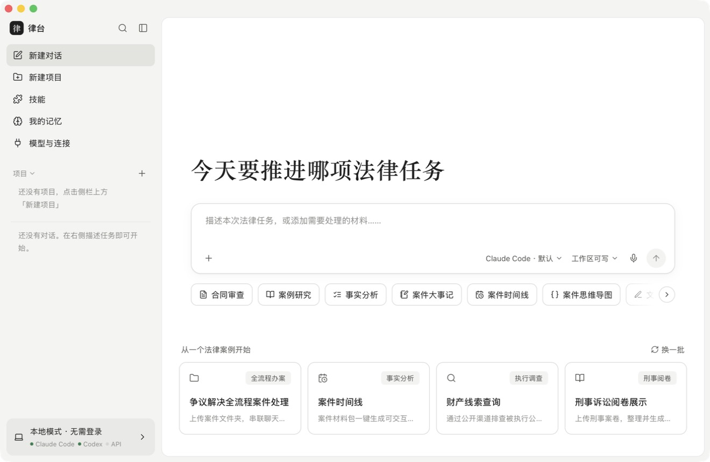

# 律台 · 本地法律智能体

一个跑在自己电脑上的法律 Agent 工作台：合同审查、案例研究、事实分析、案件时间线、文书起草……

- **不需要登录**：没有账号体系，只监听 `127.0.0.1`
- **模型用你自己的**：本机已装好的 Claude Code / Codex 命令行，或者你自己的 API Key（DeepSeek、Kimi、通义、OpenAI、Anthropic、Ollama 等）
- **数据全在本地**：对话、上传的材料、生成的文件都在你自己的电脑上
- **零依赖**：Node.js 原生实现，没有 npm 包；另有 Mac 客户端



## 下载 Mac 客户端

到 [Releases](../../releases) 下载 `LawDesk-<版本>-arm64.dmg`（Apple 芯片），打开后把「律台」拖进「应用程序」。

App 没有经过 Apple 公证，第一次打开时请在「访达」里右键 →「打开」，或到「系统设置 → 隐私与安全性」点「仍要打开」。

## 从源码运行

需要 Node.js 18 以上，没有任何 npm 依赖。

```bash
git clone https://github.com/245678000000/lawdesk.git
cd lawdesk
npm start
```

或者在访达里双击 `启动律台.command`。浏览器会自动打开 http://127.0.0.1:3721 。

换端口：`PORT=4000 npm start`；换数据目录：`LAWDESK_HOME=~/律台数据 npm start`。

## Mac 客户端说明

`mac/build.sh` 打包出 `dist/律台.app` 和 `dist/LawDesk-<版本>-<架构>.dmg`。

- 客户端是原生窗口（Swift + WebKit），内置 Node，不需要另外装 Node.js；后台服务随 App 启动、随 App 退出。
- 数据保存在 `~/Library/Application Support/LawDesk`（菜单「文件 → 打开数据文件夹」），日志在 `~/Library/Logs/LawDesk/server.log`。
- 会自动读取你在终端里的 PATH 和环境变量（`~/.zshrc` 等），所以能找到 `claude`、`codex`。
- 重新打包：`mac/build.sh`（只打本机芯片）或 `ARCH=universal mac/build.sh`（同时支持 Apple 芯片和 Intel，体积约翻倍）。需要 Xcode 命令行工具。
- App 是自签名的，没有经过 Apple 公证。
- 安装包内置 Node.js 运行时，其许可证见 `mac/NODE_LICENSE`（也会复制到 App 内）。

## 三种模型来源

| 来源 | 能力 | 用到的命令 / 接口 |
|---|---|---|
| Claude Code（本机） | 读写本地文件、执行多步任务、联网检索、生成 HTML/Word 等交付物 | `claude -p --output-format stream-json` |
| Codex（本机） | 同上 | `codex exec --json` |
| 自有 API | 纯对话；附件（PDF/Word/TXT）先转成文字再发送 | OpenAI 兼容 `/chat/completions` 或 Anthropic `/v1/messages` |

- 两个 CLI 沿用你在终端里的登录状态和配置（`~/.claude`、`~/.codex`），先在终端里确认 `claude`、`codex` 能正常对话。
- 想让 CLI 走你自己的 API：在「模型与连接」里给 Claude Code 填环境变量，例如 `ANTHROPIC_BASE_URL=…`、`ANTHROPIC_AUTH_TOKEN=…`；Codex 同理。
- 自有 API 内置了 DeepSeek、Kimi、通义千问、智谱、OpenAI、Anthropic、OpenRouter、Ollama 预设，填 Key 和模型名即可，每个都可以点「测试连接」。

## 权限（输入框右下角）

| 选项 | Claude Code | Codex |
|---|---|---|
| 只读 | `--permission-mode dontAsk`，只放行读取、搜索、联网 | `-s read-only` |
| 工作区可写（默认） | `acceptEdits`，可写文件，不能执行命令 | `-s workspace-write` |
| 全部允许 | `--dangerously-skip-permissions` | `--dangerously-bypass-approvals-and-sandbox` |

「全部允许」不会再逐项确认，智能体可以执行任意命令，只在你信任的材料上使用。

## 功能

- **技能**：合同审查、案例研究、事实分析、案件大事记、案件时间线、案件思维导图、文书起草、法规检索、风险评估。每个技能是一段追加到系统提示里的工作方法，可在「技能」页改写或新建。
- **项目**：可以关联一个本机案卷文件夹（可点「选择…」弹出访达选择），项目里的对话会把它当作工作目录，智能体直接读取全部材料；还可以写项目说明（立场、管辖法院等）。
- **我的记忆**：执业身份、文书偏好等长期信息，每次任务都会带上。
- **工作区文件**：每个对话有自己的工作区，`附件/` 是上传的材料，`输出/` 是智能体生成的报告、文书、时间线 HTML，点右上角「工作区文件」查看或下载。
- 上传支持点选文件、整个文件夹、拖拽、粘贴；时间线和思维导图里的 mermaid 图会自动渲染（需要能访问 jsdelivr，离线时显示代码）。
- 切换模型来源后会把之前的对话记录带给新的模型；同一来源连续对话会续接 CLI 会话（`--resume` / `codex exec resume`）。

## 目录

```
server.js          本地 HTTP 服务、任务调度、SSE 流
lib/cli.js         Claude Code / Codex 的调用与事件解析
lib/api.js         OpenAI 兼容 / Anthropic 接口
lib/skills.js      内置技能、首页示例
lib/store.js       data/ 下的 JSON 存储
lib/extract.js     API 模式下的附件转文字（textutil、pdftotext）
public/            前端（原生 JS，无构建步骤）
mac/               Mac 客户端：main.swift（窗口外壳）、make-icon.swift（图标）、build.sh（打包 dmg）
dist/              打包产物：律台.app、律台.dmg
data/              运行后生成：config.json、conversations/、workspaces/、memory.md
```

## 注意

- API Key 以明文保存在 `data/config.json`，不要把 `data/` 分享给别人。
- 扫描版 PDF 在 API 模式下读不出文字，用 CLI 模式或先 OCR。
- 输出仅供专业人员参考，法条与案例请自行核实。

## 许可证

[MIT](LICENSE)
